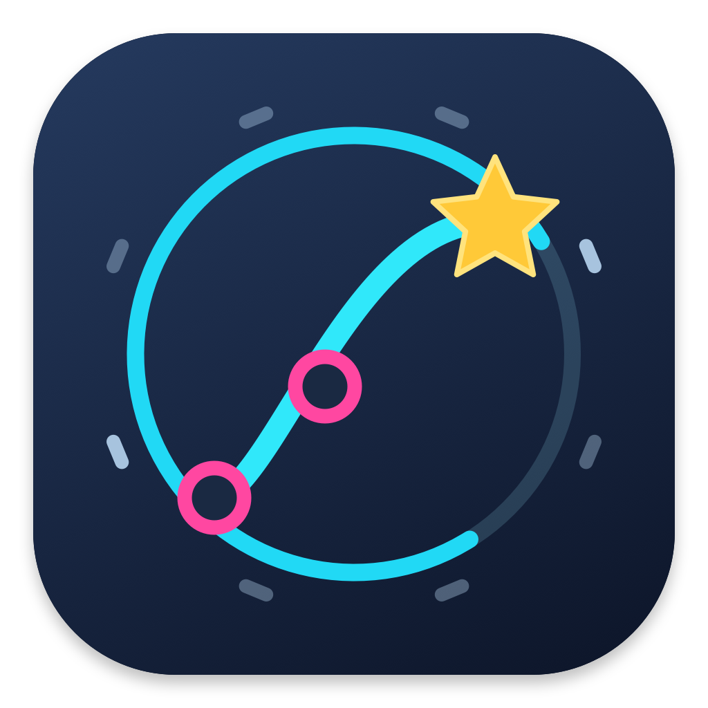

<p align="center"></p>

# Majdata Mac

面向 macOS 26 及以上的原生 simai 谱面编辑器与预览工具。界面使用 SwiftUI，渲染使用 Canvas / Metal，音频使用 AVAudioEngine。基于 MajdataView / MajdataEdit 的资源、几何和行为移植，独立维护，与 SEGA 或 TeamMajdata 无隶属关系。

当前正式版 **1.0.0**，支持 **macOS 26+、Apple silicon（M 系列）**。已在 macOS 27.0.1 上构建和测试；macOS 26 实机尚未复测。本次不提供 Intel 安装包。仍有未移植功能，见[功能核对](Documentation/Feature-audit.txt)。

**1.0.0 安装包已修订为 build 16**：修复谱面提前结束导致音乐截断，加入最后一个音符完成时的原版 All Perfect 动画及音效。音乐尾段在预览和导出中完整保留；下载过 build 15 的用户请重新下载安装。

## 下载与安装

**[下载最新正式版](https://github.com/wzk112/MajdataMac/releases/latest)** · [v1.0.0 发布说明](https://github.com/wzk112/MajdataMac/releases/tag/v1.0.0)

1. 下载 `MajdataMac-1.0.0-macOS-arm64.dmg`，打开后将 **Majdata Mac.app** 拖入 **Applications（应用程序）**。升级前先保存谱面并退出旧版。
2. 从「应用程序」双击启动。如果提示“Apple 无法验证此 App 是否包含恶意软件”或“无法验证开发者”，先关闭提示。
3. 打开 **系统设置 → 隐私与安全性**，向下找到 Majdata Mac，点击 **仍要打开（Open Anyway）**，按系统要求认证，再确认打开。必须先尝试启动，设置中才会出现这一项。
4. 首次确认后，通常可以直接双击启动。ZIP 包解压后同样将 App 拖入「应用程序」。GitHub 自动生成的 `Source code` 是源码，不是安装包。

**签名说明：** 本版使用完整性校验用的 ad-hoc 签名，**没有 Developer ID 分发签名，也未经过 Apple 公证**。上述步骤使用 macOS 提供的单个 App 放行入口；安装包没有关闭 Gatekeeper、删除隔离属性或修改系统安全设置的脚本。不同 macOS 版本或受管理电脑的提示可能不同，不能把本地启动成功当作所有机器都已验证。

若提示“已损坏”，不要将其当成正常安装提示：重新从本仓库下载，对照 Release 的 `SHA256SUMS.txt` 校验，并提交系统版本、提示截图和校验结果。**不要关闭系统安全检查，也无需运行来源不明的修复命令。** 详细说明见[安装说明](Documentation/Install.md)和 [Apple 的官方打开步骤](https://support.apple.com/zh-cn/102445)。

## 功能

- 七个难度的 simai 编辑、语法定位、查找替换、镜像/旋转、细分和自动恢复快照。
- 原始 Skin/SFX、42 组滑条几何、动画曲线、Touch/Hold/WiFi/Break 和 Metal 烟花。
- 音频主时钟、变速、PV、独立舞台；主预览与独立舞台分别选择刷新率。独立舞台始终居中，拉宽后两侧显示谱面信息、分类计数、判定统计和达成率。
- 烟花、击打光效、长押粒子分别可开关；预览和导出共用并记住设置，音效通过混音器单独控制。判定区按压高亮也可独立关闭，保留轮廓与编号。
- 视频导出默认包含原版 5 秒录制开场：封面、难度、等级、曲名、作曲、谱师、信息卡动画和开场音效；可关闭，支持 `clock_count`。
- 最后一个音符（包括 Hold/Slide 尾部）完成后显示原版 All Perfect 发光动画与音效；音乐继续到自身结尾，短音乐会保留动画所需尾段。实验区域模拟有非 Perfect 结果时不显示 AP。
- 导出支持 720/1080/1440/2160 方形和 720p/1080p/1440p/4K 16:9，均为 60 fps；默认 HEVC 硬件编码，也可选择 H.264；宽屏可包含谱面信息。
- 九路音量、主音量、静音/独奏、电平及默认音量；WAV/MP4 导出使用相同混音设置。系统输出切换后自动重连并保留播放位置。
- 默认 Classic 自动播放，直接给出最高判定。另提供实验区域输入模拟：34 块触屏区域、8 个独立外键，模拟显示、计分和音效共用记录。
- 检测可能存在的无理／撞尾与输入冲突，对比全内屏、Tap/Hold 全外键、内外配合，定位时间与源码并报告触发来源和提前量；结果是风险提示，不把模拟低判直接等同于无理谱。
- 代码/舞台之间、时间轴上边缘、侧栏和设置栏均可拖动调整尺寸。
- 时间轴支持固定坐标拖动、平移、缩放、分音吸附、小节/拍/分音网格。青色实线是播放位置，紫色虚线是源码光标位置。
- 源码青色光标和背景标记当前播放单元，紫色保留编辑光标，橙色背景标记仍在持续的 Hold/Slide。

0.3.5–0.3.7 将高频舞台更新与 App/Scene、窗口布局、静态控件分离，并缓存重复计分文字。所有谱面信息、判定数据和特效保留。当前仍是 Canvas 渲染与 Metal 烟花着色器，并非独立 MTKView 引擎；音频采样间按主机时钟插值；导出复用渲染图并连续解码 PV，Core Image 使用 Metal 做背景帧颜色转换和输出帧传输。实际刷新验证与限制见 [渲染记录](Documentation/Rendering-status.txt)。

0.3.9 同机 10 秒 4K60 片段实测：原 H.264/CPU 帧传输约 8.32 秒，Metal 帧传输 + HEVC 约 5.03 秒，耗时减少约 40%。PV、特效、侧栏、码率与分辨率均保留；这是本机片段对照，不代表所有曲目。H.264 仍可用于兼容旧设备。

0.3.8 修复了打开独立舞台时报告的时间轴文字绘制崩溃；保留全部时间和网格标记，并加入连续重绘验证。

## 构建与运行

需要 Xcode 26+、macOS SDK 和 Metal Toolchain，无第三方 Swift 依赖。

```sh
./Scripts/build-app.sh release
swift test -c release
```

应用位于 `dist/Majdata Mac.app`，可复制到「应用程序」。脚本默认使用 ad-hoc 签名并验证资源完整性，不包含 Apple 公证。可通过 `CODESIGN_IDENTITY` 指定自己的签名身份；公开分发应使用 Developer ID Application 证书并完成公证，不要使用 Apple Development 证书代替分发证书。缺少 Metal 编译器时，通过 Xcode 安装组件，或运行 `xcodebuild -downloadComponent MetalToolchain`。

运行 `./Scripts/package-release.sh` 生成 DMG、ZIP、安装说明和 SHA-256 校验文件。发布流程见[发布说明](Documentation/Releasing.md)。

构建也会生成 SwiftPM 资源包，请通过打包后的 `.app` 使用。`Package.swift` 可直接在 Xcode 中打开。自动播放测试关闭扬声器输出，保留实际引擎和采样时钟。

## 使用

⌘O 打开谱面文件夹或 `maidata.txt`，同目录可放 `track.mp3` / `track.wav`、背景图片和 `pv.mp4`。文件菜单提供内置合成音频示例。

| 操作 | 快捷键 / 方式 |
| --- | --- |
| 播放 / 暂停 | ⇧⌘C |
| 停止 | ⇧⌘X |
| 独立舞台 / 混音器 | ⇧⌘P / ⇧⌘M |
| 判定区 | ⇧⌘J |
| 前后逐帧 | ⌥⌘← / ⌥⌘→ |
| 时间轴定位 | 单击或拖动，左右边缘自动滚动，松手恢复此前播放状态 |
| 时间轴平移 | 滚轮 / 触控板，或底部区间滑块 |
| 时间轴缩放 | 放大/缩小按钮、双指捏合，或 Option + 滚动 |
| 全曲跳转 | 独立“播放进度”滑块；不受时间轴放大范围限制 |
| 位置标记 | 青色播放线；紫色源码光标线；底部按钮定位 |

Classic 自动播放时，宽屏右栏不显示五档判定数量和 FAST/LATE；区域模拟模式继续显示判定明细。

独立舞台拉宽后显示完整信息区，窄窗口自动隐藏侧栏并保持舞台居中。“画面特效”菜单位于独立舞台工具栏，主窗口右侧也有相同开关。视频保存窗口提供分辨率、宽屏信息区及特效选项；方形视频只显示舞台。

时间轴“每小节”按四分音符计拍，是显示设置；simai `{8}` 表示八分音符，不是八拍小节。BPM 改变时参考线间距变化，分音改变时下方分音刻度变化。拍数、播放速度和分音互不替代。

## 判定范围

原版 MajdataEdit 的 Classic 对应 View 的 AutoPlayMode.Enable，直接赋予最高判定，跳过触屏输入检查。0.3.3 修正旧版默认启用区域模拟的问题；升级首次恢复 Classic，之后记住用户明确选择的模式。区域高亮仍可显示，但在 Classic 下只演示音符位置。实验模拟尚未与原版 DJAuto 对齐，检查页的 GOOD/MISS 不能当作原版播放成绩。

Tap/Hold 可使用外键或触屏 A 区；Touch 只能使用触屏，Slide 读取触屏区域队列。内外配合会将占用 A 区 Touch 的 Tap/Hold 分配到外键，是一种局部输入策略，不是完整双手动作求解。

实验模拟中，滑条提前进入 A 区仍然可以触发 Tap，之后按外键不能撤销早判。全内屏、全外键和内外配合可能产生不同结果，检查页会同时列出数量。详细配置和研究来源见[判定说明](Documentation/Judgement-reference.txt)。这不是 SEGA 官方判定规格。

尚未实现手动游玩/实体控制器输入、普通播放的 OP 模式及 AP 结尾、全部原版设置与外部服务，也未完成与 Windows Unity 的逐帧像素对比。模拟全 Critical 不能证明真人可打。

虚拟声卡录音需让系统输出流经虚拟设备或多输出设备，并让录屏软件采集对应输入。仅安装虚拟驱动不会自动捕获扬声器声音。声音设置支持“跟随系统”或指定输出设备，并显示音频引擎实际连接的设备。0.3.10 显式绑定设备并读回核对，监听虚拟设备创建/移除，设备就绪延迟时重试；iShot 实际采集效果待用户验证。

## 项目结构

- `Sources/MajdataCore`：解析、谱面变换、输入判定、冲突分析和时间轴数学。
- `Sources/MajdataMac`：界面、编辑器、渲染、音频和导出。
- `Tests`：核心、AppKit 编辑交互、混音和视频导出回归。
- `Scripts`：应用打包、Metal 编译、资源提取和图标生成。
- `Documentation`：上游清单、功能差异、验证记录和判定依据。
- `Assets`：原创应用图标。`dist` 和 `.build` 是忽略的生成目录。

只包含内置示例，不包含用户下载的谱面、歌曲、PV 或验证录像。外部谱面回归由本地环境变量启用，正常构建无需这些文件。资源重新提取步骤见 [README.txt](README.txt)。

## 许可与来源

GNU GPL v3，见 [LICENSE](LICENSE) 和 [NOTICE.txt](NOTICE.txt)。上游固定提交、原始资源来源与保留的许可证在说明中列出。MaiMuriDX 仅作为研究参考，没有复制其代码或素材。

[MajdataView](https://github.com/LingFeng-bbben/MajdataView) · [MajdataEdit](https://github.com/LingFeng-bbben/MajdataEdit) · [MajdataPlay](https://github.com/TeamMajdata/MajdataPlay) · [simai 语法](https://w.atwiki.jp/simai/pages/1003.html)
